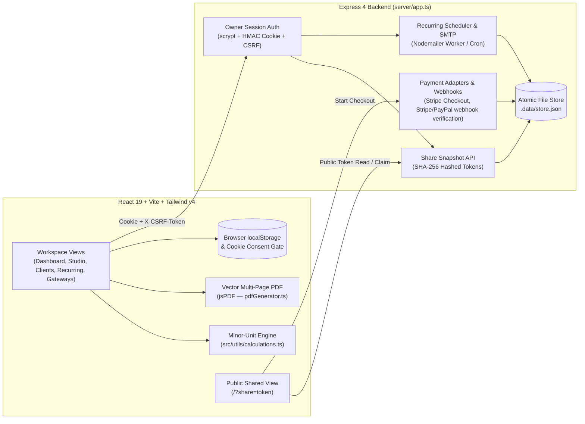

# Universal Invoice Generator

**Create. Customize. Invoice.**

Universal Invoice Generator is a modern, minimal fintech SaaS workspace designed for individuals, freelancers, agencies, educational institutions, shops, and service providers to create, customize, export, and share client-ready invoices without the complexity of heavyweight accounting or ERP platforms.

Created and led by **Muhammad Abdul Samad Tariq** (**CEO & Founder** · BS Artificial Intelligence, Riphah International University).

---

## Architecture Overview



---

## Core Capabilities

- **Create Invoice Studio (`src/components/CreateInvoiceView.tsx`)**:
  - Split-screen live editing workspace with responsive mobile toggle, Business Profile syncing, Client Directory pre-fill, and creator-only `internalNotes` (stripped from public share links and PDF exports).
  - Supports `Modern`, `Classic`, and `Minimal` templates, custom accent colors, typography styles, header/footer variants, and status tracking (`draft`, `sent`, `unpaid`, `paid`, `overdue`, `cancelled`).
- **Exact Minor-Unit Financial Engine (`src/utils/calculations.ts`)**:
  - Integer minor-unit arithmetic (`0` decimals for `JPY`/`PKR`, `2` decimals for `USD`/`EUR`/`GBP`/`AED`/`CAD`/`AUD`/`SAR`/`INR`) eliminating IEEE-754 floating-point drift.
  - Supports per-item discounts, invoice-level discounts (`percent` or `fixed`), tax treatments (`after_discount`, `before_discount`, `tax_inclusive`), invoice-level fallback tax rates (`item.taxRate === undefined` inherits `invoiceTaxRate`; explicit `0` stays `0%` zero-rated), and multi-rate `taxBreakdown`.
  - Configurable invoice numbering (`prefix`, `resetYearly`, `padLength`) and safe currency formatting (`formatCurrency` for web UI, WinAnsi-safe `formatCurrencyForPdf` for PDF fonts).
- **Genuine Multi-Page Vector PDF Engine (`src/utils/pdfGenerator.ts`)**:
  - Programmatic `jsPDF` A4 layout with repeating table headers across page breaks, tax breakdowns, payment instructions, full-page signature/stamp rendering (`authElements[]`), and timeout-guarded image rasterization.
  - Distinct **Download PDF**, inline **Preview PDF**, and **Print Invoice** actions.
- **Full-Page Signature & Stamp Studio (`src/components/SignatureStampStudio.tsx`)**:
  - Place multiple signatures and company seals anywhere across the invoice canvas with drag, resize, `-45°` to `+45°` rotation, opacity, z-index layering, alignment helpers, undo/redo history, upload validation (`PNG`, `JPEG`, `SVG`, `WebP` up to `2 MB`), and saved asset library management.
- **Hardened Cross-Device Share Links & Owner Sessions (`server/auth.ts`, `server/store.ts`)**:
  - Single-owner HTTP-only signed session cookie (`uig_session`) + `X-CSRF-Token` validation protects state-changing owner endpoints (`/api/shares`, `/api/shares/:token`, `/api/invoices/:id/manual-payment`, `/api/payment-providers/:id/verify`, `/api/recurring/*`).
  - Public share tokens (`crypto.randomBytes(24).toString('base64url')`) are stored strictly as SHA-256 digests (`tokenHash`) in `.data/store.json`—raw tokens are never written to disk or echoed in `GET /api/shares/:token`.
  - Public responses strip `internalNotes`, `clientId`, `recurringScheduleId`, `deliveryError`, `shareToken`, `pendingClaims`, and `paymentHistory`; payer claim submissions never return other payers’ claim details.
- **Honest Payment Gateways, Stripe Checkout & Webhook Verification (`server/paymentAdapters.ts`)**:
  - Catalog covering Stripe and PayPal online gateway integrations, plus manual wallet and bank remittance methods.
  - Secret keys stay strictly server-side. Without valid server credentials, providers accurately report `Not Configured` or `Setup Required` instead of fabricated success.
  - Supports live Stripe Checkout Session creation (`/api/payments/stripe/checkout-session`), live provider probes (`/api/payment-providers/:id/verify`), HMAC/replay-protected webhook verification (`/api/webhooks/payments/:providerId`) with minor-unit currency & amount checks, public payer remittance claims (`pending_verification` only—never auto-marking `paid`), and owner manual settlement confirmation.
- **Recurring Invoices, Calendar Safety & SMTP Dispatch (`src/utils/recurring.ts`, `server/recurringWorker.ts`)**:
  - Supports `daily`, `weekly`, `monthly`, `quarterly`, and `yearly` schedules with strict calendar validation (`parseIsoDate`), `anchorDay` preservation across short months (`Jan 31 -> Feb 28 -> Mar 31`), and idempotent `(scheduleId, issueDate)` duplicate prevention.
  - Optional backend scheduler (`ENABLE_RECURRING_WORKER=true`) and authenticated cron endpoint (`POST /api/recurring/process-due` via owner session or `Authorization: Bearer <CRON_SECRET>`).
  - Dispatches via SMTP (`nodemailer`) when configured, reporting `accepted_by_smtp`, `setup_required`, or `failed` honestly.
- **Legal Templates & Versioned Cookie Consent (`src/utils/cookieConsent.ts`, `src/components/LegalPagesView.tsx`)**:
  - Built-in **About Us**, **Software License & IP**, **Privacy Policy**, and **Terms & Conditions** views with clear template disclaimers.
  - First-visit Cookie Consent banner, policy-version re-prompting (`isConsentRequired`), 4-category preferences modal (`Strictly Necessary`, `Functional`, `Analytics`, `Marketing`), and gated functional preference persistence (`loadFunctionalPreference`, `saveFunctionalPreference`).

---

## Project Structure

- `server.ts` — Express entry point mounting Vite dev middleware (dev) or compiled `dist/` static assets (prod) and optional recurring worker loop.
- `server/app.ts` — Express application factory (`createApp`), Helmet CSP headers, CORS allowlist, rate limiters, payload caps, and `/api/*` route handlers.
- `server/auth.ts` — `scrypt` password hashing, HMAC-signed `uig_session` cookies, CSRF verification, and `CRON_SECRET` bearer guard.
- `server/paymentAdapters.ts` — Gateway status registry, live Stripe/PayPal checks, Stripe Checkout builder, and Stripe/PayPal webhook signature verification.
- `server/recurringWorker.ts` — Server-side due-schedule runner and SMTP mail dispatcher.
- `server/store.ts` — Queue-serialized atomic JSON persistence (`writeStore`), SHA-256 share token indexing, webhook event deduplication, and payment audit trails.
- `server/validation.ts` — Runtime input validation and normalization for invoices, payment accounts, and remittance claims.
- `src/utils/calculations.ts` — Minor-unit financial math, tax/discount rules, WinAnsi PDF formatting, and invoice numbering.
- `src/utils/recurring.ts` — Calendar-safe recurring date math and idempotent invoice generation.
- `src/utils/pdfGenerator.ts` — Multi-page vector `jsPDF` builder (`buildInvoicePdfDocument`, `generateInvoicePdfBlob`, `downloadInvoicePdf`).
- `src/utils/apiClient.ts` — Same-origin credentialed `ownerFetch` + `X-CSRF-Token` client helper.
- `src/utils/cookieConsent.ts` — Versioned cookie consent storage and functional preference gating.
- `src/components/` — Modular React UI views, interactive document renderer, auth modal, and legal pages.

---

## Environment Variables

Copy `.env.example` to `.env` for local or server configuration (never commit real secrets):

| Variable | Purpose | Required in Production |
| --- | --- | --- |
| `PORT` | HTTP listen port (default `3000`) | Optional |
| `DATA_DIR` | Directory for `.data/store.json` | Optional |
| `APP_URL` / `APP_BASE_URL` | Canonical public URL for share links & Checkout redirects | Recommended |
| `ALLOWED_ORIGINS` | Comma-separated CORS allowlist for cross-origin API access | Optional |
| `SESSION_SECRET` | HMAC secret signing owner session cookies | **Yes** |
| `OWNER_EMAIL` | Workspace owner login email | **Yes** |
| `OWNER_PASSWORD_HASH` | `scrypt$<salt>$<hex>` password hash (or `OWNER_PASSWORD`) | **Yes** |
| `CRON_SECRET` | Bearer token for `POST /api/recurring/process-due` cron triggers | Optional |
| `STRIPE_SECRET_KEY` / `STRIPE_WEBHOOK_SECRET` | Live/test Stripe Checkout & webhook HMAC verification | Optional |
| `PAYPAL_CLIENT_ID` / `PAYPAL_CLIENT_SECRET` / `PAYPAL_WEBHOOK_ID` | PayPal OAuth probe & webhook verification (`PAYPAL_ENV`) | Optional |
| `SMTP_HOST` / `SMTP_PORT` / `SMTP_SECURE` / `SMTP_USER` / `SMTP_PASS` / `SMTP_FROM` | SMTP relay for recurring invoice email dispatch | Optional |
| `ENABLE_RECURRING_WORKER` / `RECURRING_CHECK_INTERVAL_MS` | Enable background due-schedule worker (`true`/`false`) | Optional |

> **Development Auth Note:** When running outside production (`NODE_ENV !== 'production'`) without `OWNER_PASSWORD` or `OWNER_PASSWORD_HASH` configured, the server boots with a random ephemeral password printed to server logs and exposed via the local Sign-In dialog's **Auto-fill** helper so developers can test authenticated workflows immediately without hardcoding credentials in source control.

---

## Scripts & Verification

```bash
# Install dependencies
npm install

# Run development server (Express + Vite middleware on port 3000)
npm run dev

# Run all unit and backend HTTP integration tests
npm test

# Type-check codebase
npm run lint

# Build production client (dist/) and bundled Node server (dist-server/server.mjs)
npm run build

# Start compiled production server
NODE_ENV=production SESSION_SECRET=replace-me OWNER_EMAIL=owner@example.com OWNER_PASSWORD=replace-me npm start
```

---

## Known Limitations & Boundaries

- **Local-First Browser Storage**: Drafts, clients, business profiles, and uploaded logos/signatures reside in browser `localStorage` unless explicitly published via Share Links or synced when signed in for recurring server dispatch. Clearing browser storage removes unsynced local drafts.
- **Visual Signatures**: Drawn or uploaded signatures and seals customize invoice appearance and exported PDFs; they are not cryptographic PKI/eIDAS qualified electronic signatures.
- **Focused Scope**: Designed strictly for invoice authoring, calculation accuracy, PDF export, recurring schedules, and payment settlement tracking—not a multi-tenant ledger, inventory ERP, or statutory tax filing suite.
- **No Unconfigured Magic**: Email delivery requires real SMTP server credentials, and online checkout requires real gateway credentials; otherwise the UI surfaces explicit `Setup Required` / `Not Configured` states.

---

## Author & License

- **Author**: **Muhammad Abdul Samad Tariq** — CEO & Founder · BS Artificial Intelligence, Riphah International University
- **Code License**: Released under the [MIT License](LICENSE). Project brand identifiers, founder portrait, and user-uploaded assets remain separate from MIT brand endorsement.
